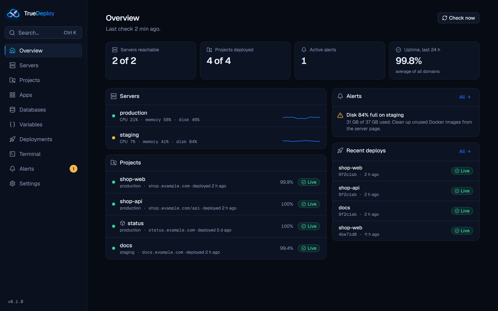
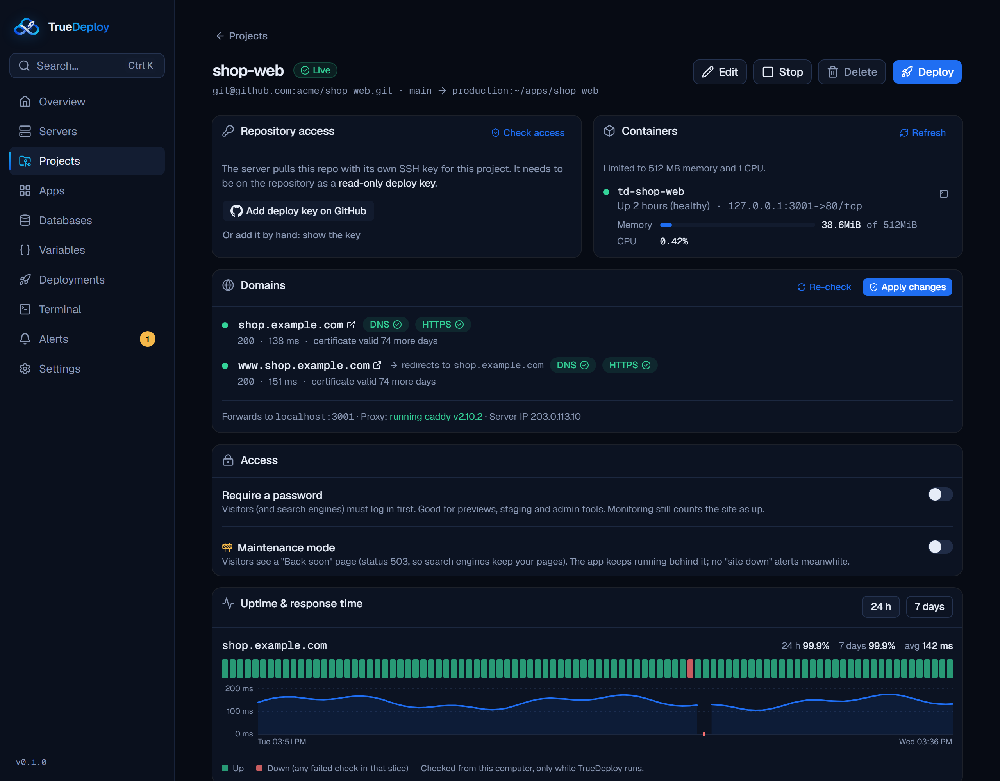
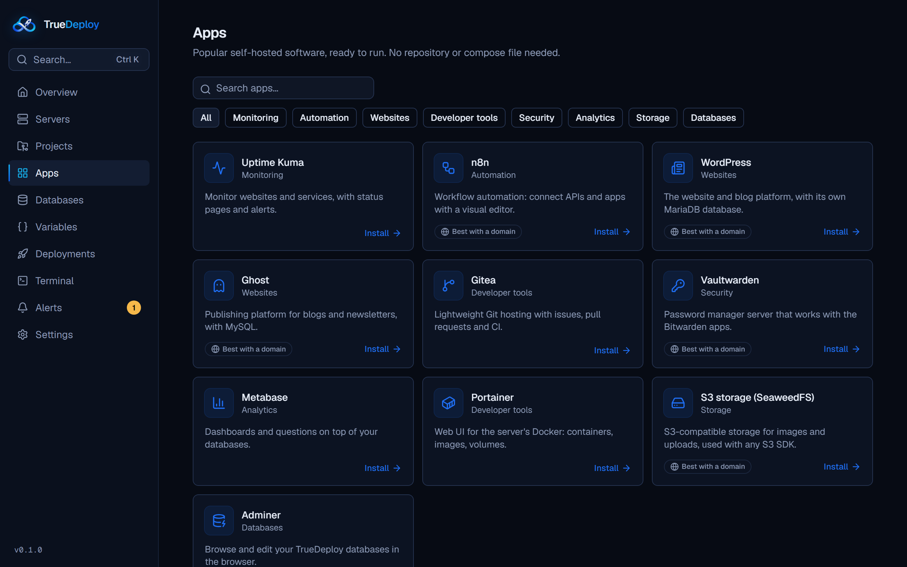

<div align="center">


# TrueDeploy

**Deploy to your own servers from your desktop.**
Set up a VPS, ship any Git repo with Docker, and get HTTPS, databases, backups and monitoring,
with nothing to install on the server and no root required.

[](https://github.com/HamzaBaghdadi/TrueDeploy/releases/latest)
[](https://github.com/HamzaBaghdadi/TrueDeploy/actions/workflows/ci.yml)
[](LICENSE)
[](#install)

[**Download**](#install) · [Features](#features) · [How it works](#how-it-works) · [Quick start](#quick-start) · [FAQ](#faq) · [Contributing](CONTRIBUTING.md)



</div>

## Why TrueDeploy?

Self-hosting your apps usually means one of two things: wiring up Docker, Nginx, certificates, backups and CI by hand, or installing a web control panel on a server (which then needs its own server, its own updates, root access and an admin page on the internet).

TrueDeploy is a third way: **a desktop app that does the work over SSH**.

- 🖥️ **Nothing extra on your servers.** No agent, no dashboard, no open port. Just Docker and the Caddy proxy that serves your sites.
- 🔐 **Your secrets stay on your computer**, encrypted with a key in your OS keychain. Servers only get what each app needs.
- 🙅 **No root required.** Set up a server with sudo, or prepare your own account on a server where you don't have it (rootless Docker included).
- 🧩 **Any stack.** Docker Compose, your own Dockerfile, or one of 30+ framework presets that write the Dockerfile for you.
- 🪶 **Works with what you already have.** Import apps, databases and Nginx sites from a server you set up before TrueDeploy.

## Features

<table>
<tr><td width="50%" valign="top">

**🚀 Deploy**
- Docker Compose or a Dockerfile, from **GitHub, GitLab, Bitbucket or Gitea/Forgejo** (cloud or self-hosted)
- **Framework presets** generate the Dockerfile: Next.js (static, SSR, standalone), Nuxt, SvelteKit, Remix, Astro, Angular, Vue, React, NestJS, Node.js, Django, Flask, FastAPI, Laravel, Rails, Spring, Go, Rust, .NET and more
- **Detect framework** reads the repo and suggests the right setup
- **Auto-deploy on push** through your Git host's CI, with a key that can run only that deploy
- **Health checks** after every deploy and **automatic rollback** to the last healthy commit
- **Branch previews** on their own subdomain
- One-click **rollback** to any earlier deploy

</td><td width="50%" valign="top">

**🌐 Domains & HTTPS**
- Automatic HTTPS certificates (Caddy)
- **Path routing**: frontend on `shop.com`, backend on `shop.com/api`, from two separate repos
- **Redirects** (`www.shop.com` → `shop.com`)
- **Password protection** and a **maintenance page** per project
- DNS, HTTPS, certificate and response-time checks

**🗄️ Data**
- Managed **PostgreSQL, MySQL, MongoDB and Redis**, linked to apps with generated credentials
- Scheduled **backups** of databases and Docker volumes, with one-click restore
- **Offsite copies** to any S3-compatible storage (AWS, Cloudflare R2, Backblaze B2, Wasabi, Spaces, MinIO)

</td></tr>
<tr><td valign="top">

**📊 Operate**
- Live **logs** with search, error filter, time ranges and download
- CPU, memory and disk history, uptime and response-time charts
- **Alerts** for down servers, full disks, failing sites, expiring certificates and failed deploys, sent to the desktop, **Discord, Slack, Telegram** or a webhook
- **Cron jobs** inside your containers
- **Resource limits** (memory and CPU) per project
- A built-in **terminal**: on the server, or inside any container

</td><td valign="top">

**🧰 And more**
- **One-click apps**: Uptime Kuma, n8n, WordPress, Ghost, Gitea, Vaultwarden, Metabase, Portainer, Adminer, S3 storage
- Shared **variable groups** across projects
- Server setup: Docker, firewall, automatic security updates, SSH keys, password login off
- **Import** an existing server's Compose apps, databases and Nginx sites
- Encrypted **export/import** of everything to move to a new computer
- **Command palette** (Ctrl/⌘ K) and automatic, verified **self-updates**

</td></tr>
</table>

<p align="center">
  
  
</p>

## Install

Download the latest version for your computer from the **[Releases page](https://github.com/HamzaBaghdadi/TrueDeploy/releases/latest)**:

| Platform | File | Notes |
|---|---|---|
| **Windows** 10/11 | `TrueDeploy-…-windows-amd64-setup.exe` | Installs for your user only, no admin needed. A portable `.exe` is also available. |
| **macOS** 12+ | `TrueDeploy-…-macos-universal.dmg` | Apple silicon and Intel. |
| **Linux** x64 | `.AppImage`, `.deb` or `.rpm` | Needs GTK 4 and WebKitGTK 6.0 (Ubuntu 24.04+, Debian 13+, Fedora 40+). |

TrueDeploy updates itself: new versions download in the background, are checked against the release's SHA-256 checksums, and install when you restart (or quit) the app. Linux `.deb`/`.rpm` installs update through your package manager instead.

> [!NOTE]
> The builds aren't code-signed yet, so the first launch needs one extra click:
> - **Windows:** if SmartScreen appears, click **More info → Run anyway**.
> - **macOS:** right-click TrueDeploy in Applications → **Open** → **Open**. (Or run `xattr -dr com.apple.quarantine /Applications/TrueDeploy.app`.)
> - **Linux AppImage:** `chmod +x TrueDeploy-*.AppImage`, then run it.

### What your server needs

- Any Linux server you can reach over **SSH** (a VPS, a dedicated server, a home lab box).
- **Debian or Ubuntu** for the one-click server setup (Docker, firewall, updates). Other distributions work if Docker is already installed.
- Ports **80 and 443** open for domains with HTTPS.

## How it works

```
 Your computer                                Your server
┌────────────────────────────┐   SSH    ┌───────────────────────────────────────┐
│ TrueDeploy                 │ ───────► │ Docker                                │
│  · servers, projects       │          │  ├─ your apps (Compose / Dockerfile)  │
│  · encrypted secrets       │          │  ├─ databases (private network)       │
│  · monitoring and alerts   │          │  └─ Caddy: HTTPS, domains, redirects  │
└────────────────────────────┘          │ cron: backups, jobs                   │
                                        │ ~/apps, ~/truedeploy (plain files)    │
 Git host (GitHub, GitLab, …)           └───────────────────────────────────────┘
  push ─► CI ─► SSH with a locked key ─► runs that project's deploy hook only
```

- Every action is a short, readable **bash script sent over SSH**. Your servers keep plain files and standard tools: `docker compose ps` works exactly as you'd expect, and you can stop using TrueDeploy any time without migrating anything.
- Deploys clone your repo on the server with a **read-only deploy key** (one per project), build with Docker, run the health check, and record what happened.
- Backups and cron jobs run from your user's **crontab**, so they keep running when your computer is off.
- Monitoring and alerts run **while the app is open** (it can stay in the system tray).

## Quick start

1. **Add a server:** host, user and an SSH key or password. TrueDeploy pins the server's host key.
2. **Set it up:** install Docker, a firewall and security updates, or choose *no sudo* to prepare just your account.
3. **Connect your Git host** in Settings (optional): pick repos, add deploy keys and turn on auto-deploy in one click.
4. **Create a project:** choose a repo, then Docker Compose, your Dockerfile, or a framework preset.
5. **Add a domain** and click **Deploy**. HTTPS is set up automatically.

### Example: a frontend and an API from two repos, on one domain

| Project | Repo | Runs as | Domain |
|---|---|---|---|
| `shop-web` | `acme/shop-web` (Next.js static export) | Preset *Next.js (static export)*, served by Nginx | `shop.com` |
| `shop-api` | `acme/shop-api` (NestJS) | Preset *NestJS* | `shop.com/api` |
| `shop-db` | — | Managed PostgreSQL, linked to `shop-api` as `DATABASE_URL` | — |

No Compose file needed: the presets write the Dockerfiles, Caddy routes `/api` to the backend, and the database joins a private network only the API can reach. Add a daily backup with an offsite copy, turn on auto-deploy for both repos, and every push to `main` ships.

## FAQ

<details>
<summary><b>How is this different from Coolify, Dokploy or CapRover?</b></summary>

They're excellent self-hosted platforms: a web dashboard that runs on a server and manages your other servers. TrueDeploy makes a different trade-off. It runs on **your computer**, so there's nothing to install, update or secure on the server beyond Docker and Caddy, and it works **without root**. In exchange, monitoring runs only while the app is open, and there are no team accounts yet. If you want a 24/7 dashboard for a team, a server-side platform may suit you better.
</details>

<details>
<summary><b>What happens if I uninstall TrueDeploy?</b></summary>

Your apps keep running. Everything on the server is standard Docker, Compose files, a Caddyfile and crontab entries in your home folder, so you can manage it by hand from then on.
</details>

<details>
<summary><b>Where is my data stored?</b></summary>

On your computer: `%APPDATA%\TrueDeploy` on Windows, `~/Library/Application Support/TrueDeploy` on macOS, `~/.config/TrueDeploy` on Linux. Secrets are encrypted with AES-256-GCM using a key kept in your OS keychain. Use **Settings → Backup of TrueDeploy** to export everything to one passphrase-encrypted file.
</details>

<details>
<summary><b>Can I use it without sudo or root?</b></summary>

Yes. Choose *no sudo* during setup and TrueDeploy prepares your own account, including rootless Docker when the server supports it. A few things need an admin once (opening ports 80/443 for HTTPS, for example); the app tells you exactly what to ask for.
</details>

<details>
<summary><b>Does it phone home?</b></summary>

No analytics or tracking. The app talks to your servers, to the Git hosts and storage you connect, and once a day to GitHub to check for updates (you can turn that off in Settings).
</details>

## Contributing

Bug reports, ideas and pull requests are welcome! See **[CONTRIBUTING.md](CONTRIBUTING.md)** for setting up a development environment (Go, Node and the Wails CLI), how the code is organised, and the checks to run.

Found a security issue? Please report it privately: see **[SECURITY.md](SECURITY.md)**.

## Built with

[Wails v3](https://v3.wails.io) (Go + native WebView) · [Next.js](https://nextjs.org) · [Tailwind CSS](https://tailwindcss.com) · [shadcn/ui](https://ui.shadcn.com) · [lucide](https://lucide.dev) · [Caddy](https://caddyserver.com) · [Docker](https://www.docker.com) · [rclone](https://rclone.org) · [xterm.js](https://xtermjs.org)

## License

TrueDeploy is open source under the [Apache License 2.0](LICENSE).
Copyright © 2026 Hamza Baghdadi and contributors.
